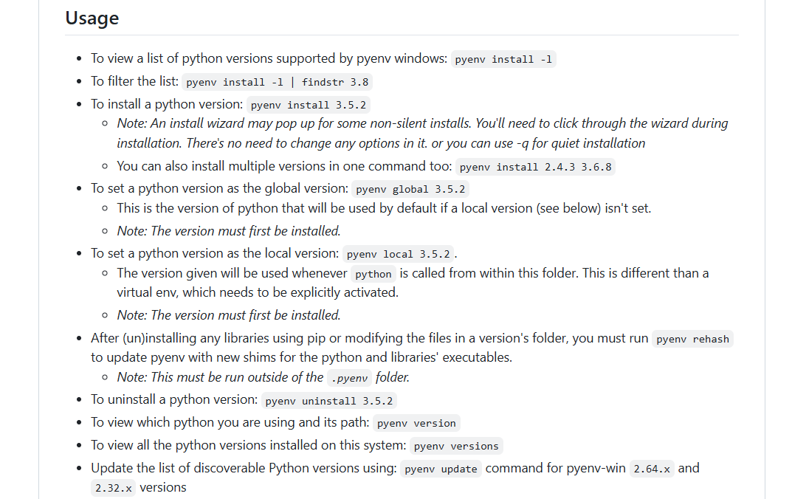

# Estudos 

## Gerenciamento de pacotes

### Pip

Tutorial instalando pip para gerenciamento de pacotes pyhton: [installing-packages](https://packaging.python.org/pt_BR/latest/tutorials/installing-packages/)

**Comandos básicos:**

* Certifique-se que pip, setuptools e wheel estejam atualizados:

    ```
    py -m pip install --upgrade pip setuptools wheel
    ```

* Listar todos os pacotes instalados
        
    ```
    pip list --outdated
    ```

#### Atualizando dependências globais do PIP:

[https://www.activestate.com/resources/quick-reads/how-to-update-all-python-packages/](https://www.activestate.com/resources/quick-reads/how-to-update-all-python-packages/)

**Powershell:**

    pip freeze | %{$_.split('==')[0]} | %{pip install --upgrade $_}
    
**Bash:**

    pip3 list --outdated --format=freeze | grep -v '^\-e' | cut -d = -f 1 | xargs -n1 pip3 install -U

### Pipenv

O [Pipenv](https://pipenv.pypa.io/en/latest/) combina `pip` e `virtualenv` em uma única ferramenta: cria/gerencia o ambiente virtual do projeto e mantém as dependências declaradas em um [`Pipfile`](#o-pipfile) (mais previsível que um `requirements.txt`).

Links úteis:

1) [pipenv](https://pipenv.pypa.io/en/latest/)

2) [advanced](https://docs.pipenv.org/advanced/)

3) [managing dependencies](https://packaging.python.org/pt_BR/latest/tutorials/managing-dependencies/)

#### Instalação

O pipenv é uma ferramenta **global**, não algo que fica dentro do ambiente de um projeto específico — por isso o ideal é instalá-lo isolado do Python de cada projeto, evitando que ele quebre quando você troca a versão do Python via `pyenv`.

**Opção recomendada (multiplataforma) — via `pipx`:**

```bash
# macOS
brew install pipx
pipx ensurepath

# Windows (PowerShell)
py -m pip install --user pipx
py -m pipx ensurepath
```
```bash
# depois, em qualquer plataforma:
pipx install pipenv
```

**macOS — alternativa via Homebrew:**

```bash
brew install pipenv
```

**Windows — alternativa via pip:**

```powershell
py -m pip install --user pipenv
```
> No Windows, garanta que a pasta de scripts do usuário (algo como `%APPDATA%\Python\Python3xx\Scripts`) esteja no `PATH` — senão o comando `pipenv` não é reconhecido depois de instalado.

Confirme a instalação (qualquer plataforma):

```bash
pipenv --version
```

#### Onde os ambientes virtuais são criados

Por padrão o pipenv **não** cria o `.venv` dentro da pasta do projeto — ele centraliza todos os ambientes numa pasta própria do usuário:

* **macOS/Linux:** `~/.local/share/virtualenvs/`
* **Windows:** `%USERPROFILE%\.virtualenvs`

Para achar o caminho exato do ambiente de um projeto específico, rode dentro da pasta do projeto:

```bash
pipenv --venv
```

#### ☤ Configuração com variáveis de ambiente¶

`PIPENV_VENV_IN_PROJECT` — se definida, o pipenv cria o ambiente numa pasta `.venv` **dentro do próprio projeto**, em vez de usar a pasta global acima. Isso facilita bastante a integração com o VS Code (veja a seção [Visual Studio Code](#visual-studio-code) abaixo).

```bash
# macOS/Linux (~/.zshrc ou ~/.bashrc)
export PIPENV_VENV_IN_PROJECT=1
```
```powershell
# Windows (PowerShell, permanente)
setx PIPENV_VENV_IN_PROJECT 1
```

**Comandos básicos:**

* Listar todos os comandos do pipenv:

    ```bash
    pipenv
    ```

* Criar o ambiente virtual (e o `Pipfile`, se ainda não existir) com uma versão específica do Python:

    ```bash
    pipenv install --python 3.11
    ```

* Instalar uma dependência (grava automaticamente no `Pipfile`):

    ```bash
    pipenv install requests
    pipenv install pytest --dev
    ```

* Ativar o ambiente virtual no terminal atual:

    ```bash
    pipenv shell
    ```

* Remover o ambiente virtual do projeto atual ("remove a virtualenv created by pipenv"):

    ```bash
    pipenv --rm
    ```

* Ver o caminho do ambiente virtual:

    ```bash
    pipenv --venv
    ```

* Ver o caminho do interpretador Python usado pelo ambiente:

    ```bash
    pipenv --py
    ```

#### O `Pipfile`

Todo projeto gerenciado pelo pipenv tem um `Pipfile` na raiz — é o substituto do `requirements.txt`, em formato TOML:

```toml
[[source]]
url = "https://pypi.org/simple"
verify_ssl = true
name = "pypi"

[packages]
requests = "*"

[dev-packages]
pytest = "*"
mypy = "*"

[requires]
python_version = "3.11"

[scripts]
start = "python main.py"
```

* **`[[source]]`** — de onde os pacotes são baixados (por padrão, o PyPI oficial).
* **`[packages]`** — dependências de produção; cada `pipenv install <pkg>` adiciona uma entrada aqui.
* **`[dev-packages]`** — dependências só de desenvolvimento (testes, linters); preenchido por `pipenv install <pkg> --dev`.
* **`[requires]`** — versão do Python exigida pelo projeto. Se você tiver o `pyenv` instalado, o pipenv usa essa informação para achar (ou sugerir instalar) o interpretador certo automaticamente.
* **`[scripts]`** — atalhos executados com `pipenv run <nome>` (ex.: `pipenv run start`).

O `Pipfile.lock`, gerado junto, fixa as versões exatas (com hashes) de tudo que foi instalado — é ele que garante que outra máquina reproduza o mesmo ambiente rodando `pipenv install`. Por isso ele **deve** ser commitado no git (diferente do `.venv`/pasta do ambiente virtual, que nunca deve ser commitada).

#### Criando o ambiente em uma subpasta específica

Este repositório tem uma pasta por curso/estudo, cada uma com seu próprio `Pipfile` — o ambiente é criado **dentro da subpasta**, não na raiz do repo:

```bash
cd nome-da-subpasta

# se a subpasta (ou uma pasta acima, via pyenv) tiver uma versão do Python
# configurada que você ainda não tem instalada, indique explicitamente
# uma versão que você já possui:
pipenv install --python 3.11

# opcional: fixa essa versão só para esta subpasta,
# sobrescrevendo o .python-version herdado de uma pasta acima
pyenv local 3.11
```

## Visual Studio Code

### Múltiplos ambientes pipenv em um só repositório

Cada subpasta deste repo tem seu próprio `Pipfile`/ambiente virtual. A extensão Python do VS Code só detecta automaticamente o ambiente de uma pasta quando essa pasta é a **raiz do workspace aberto** — se você abrir `Python-Estudos/` inteiro como uma pasta única, ela não encontra o `Pipfile` de uma subpasta como `curso-x/`.

Duas formas de resolver:

#### Opção 1 — Abrir a subpasta diretamente

```bash
code nome-da-subpasta
```
Mais simples, mas você perde a visão do repo inteiro numa janela só.

#### Opção 2 — Workspace multi-root

Um arquivo `.code-workspace` permite abrir várias pastas como "raízes" independentes dentro de uma única janela do VS Code, cada uma com seu próprio interpretador Python selecionado. Este repositório já tem um: [`Python-Estudos.code-workspace`](./Python-Estudos.code-workspace), com todas as subpastas listadas.

Para usar: `File > Open Workspace from File...` e selecione esse arquivo (em vez de `Open Folder`). Para adicionar novas pastas depois, use `File > Add Folder to Workspace...` — o VS Code atualiza o arquivo automaticamente.

#### `.vscode/settings.json` por subpasta

Dentro de uma raiz do workspace (a pasta inteira aberta na Opção 1, ou uma das entradas do multi-root da Opção 2), um `.vscode/settings.json` local aponta o interpretador certo:

```bash
cd nome-da-subpasta
pipenv --venv   # copie o caminho retornado
```

```json
{
  "python.defaultInterpreterPath": "/caminho/retornado/por/pipenv --venv/bin/python"
}
```
> No Windows, o interpretador fica em `...\Scripts\python.exe` em vez de `.../bin/python`.

> **Importante:** esse `settings.json` só é lido pelo VS Code se a subpasta onde ele está for, ela mesma, uma raiz do workspace (Opção 1, ou uma entrada do `.code-workspace` da Opção 2). Colocá-lo dentro de uma subpasta enquanto o VS Code tem só a pasta-pai aberta como raiz única **não funciona** — o arquivo é ignorado silenciosamente.

Se quiser que o `.venv` fique dentro da própria subpasta (mais fácil de localizar), exporte `PIPENV_VENV_IN_PROJECT=1` antes de criar o ambiente (veja a seção [Pipenv](#pipenv) acima) — assim o caminho do interpretador fica previsível (`./.venv/bin/python` ou `.\.venv\Scripts\python.exe`).

### ✳ Configurar debug no VSCode

Com o interpretador certo já selecionado (seção anterior), o debugger é configurado por pasta/projeto, através de um `launch.json` dentro de `.vscode/`.

1. Abra a pasta do projeto (ou garanta que ela é uma raiz do workspace, como acima).
2. `Ctrl+Shift+P` (`Cmd+Shift+P` no macOS) → **Python: Select Interpreter** → escolha o ambiente do pipenv daquela pasta (a extensão já lista os ambientes pipenv encontrados).
3. Abra a view **Run and Debug** (`Ctrl+Shift+D` / `Cmd+Shift+D`) → **create a launch.json file** → escolha **Python Debugger** → **Python File**. Isso cria `.vscode/launch.json` dentro da pasta.
4. A configuração gerada já cobre o caso mais comum — depurar o arquivo aberto no editor:

    ```json
    {
      "version": "0.2.0",
      "configurations": [
        {
          "name": "Python: Current File",
          "type": "debugpy",
          "request": "launch",
          "program": "${file}",
          "console": "integratedTerminal",
          "justMyCode": true
        }
      ]
    }
    ```

5. Para sempre depurar o mesmo arquivo de entrada (ex.: `main.py`), independente do que estiver aberto no editor, adicione outra configuração nomeada em vez de trocar a existente:

    ```json
    {
      "name": "Python: main.py",
      "type": "debugpy",
      "request": "launch",
      "program": "${workspaceFolder}/main.py",
      "console": "integratedTerminal",
      "justMyCode": true
    }
    ```
    > `${workspaceFolder}` aponta para a raiz **daquela pasta específica**. Em um workspace multi-root, cada pasta tem seu próprio `launch.json` e seu próprio `${workspaceFolder}` — por isso nunca use caminho absoluto aqui.

6. Para depurar testes com `pytest`, adicione:

    ```json
    {
      "name": "Python: Pytest",
      "type": "debugpy",
      "request": "launch",
      "module": "pytest",
      "args": ["-v"],
      "console": "integratedTerminal",
      "justMyCode": true
    }
    ```

7. Para rodar: coloque um breakpoint clicando à esquerda do número da linha, escolha a configuração desejada no dropdown do topo da view **Run and Debug** e aperte `F5` (ou o botão ▶️ verde). `Shift+F5` para parar, `F10` (step over) e `F11` (step into) para navegar linha a linha.

> Nota: em versões mais antigas da extensão Python, o `type` do debugger era `"python"` em vez de `"debugpy"`. Se um `launch.json` antigo usar `"python"`, ele ainda funciona — é só o nome de compatibilidade legado.

## Mypy:

### Documentação:
[https://mypy.readthedocs.io/en/stable/getting_started.html](https://mypy.readthedocs.io/en/stable/getting_started.html)

### Instalação:
     pipenv install mypy --save-dev

### Comandos:
    
#### Executar análise em um arquivo:
    mypy {FILE_NAME}.py


## Pipx
[https://pipx.pypa.io/stable/](https://pipx.pypa.io/stable/)

Para gerenciar executaveis python. <br>
Instalando pipx no python global: <br>
`pip install pipx` <br>
`pipx ensurepath`

Apos instaladado o `pipx`, no windows é necessário executar o comando: 
`pipx ensurepath` para adicionar os executaveis do pipx ao ambiente para ser executado
pela linha de comando.

### Comandos:

`pipx list` -> Lista pacotes instalados

`pipx install {PACKAGE_NAME}` -> Instala pacote

`pipx uninstall {PACKAGE_NAME}` -> Remove pacote

`pipx upgrade {PACKAGE_NAME}` -> Atualiza pacote

# Poetry

> Local onde os ambientes virtuais criados para o `poetry` <br>
> estão: `%USERPROFILE%/AppData\Local\pypoetry\Cache\virtualenvs` <br>


### Comandos:

`poetry config --list` -> Lista todas as configurações do poetry

`poetry env info --path` -> Exibe path de onde o `env` encontra-se 

`poetry env list` -> Lista todos os enviroments gerenciados

`poetry env remove {{POETRY_ENV_NAME}}` -> Remove enviroment selecionado

`poetry env use {{PYTHON_VERSION}}` ->  Activates or creates a new virtualenv for the current project.

`poetry new {{PROJECT_NAME}}` -> Cria novo projeto com gerenciador poetry

`poetry init` -> Inicializa projeto com gerenciador poetry

`poetry config virtualenvs.in-project true` -> Se quise configurar para o poetry criar env no mesmo diretorio do projeto

`poetry cache clear pypi --all` -> Limpar cache de arquivos baixados (Isso libera muito espaço)

`%LocalAppData%\pypoetry\Cache` -> Local onde os pacotes e caches do poetry são instalados


## Gerenciador de múltiplas versões python
[https://github.com/pyenv-win/pyenv-win](https://github.com/pyenv-win/pyenv-win)



---

## Limpando dependências Pipenv Poetry venv

### 1. Limpando o POETRY

O Poetry, por padrão, cria todos os ambientes em uma pasta centralizada e oculta, o que faz a gente esquecer que eles existem.

**Opção A: Remover um ambiente específico (Se você estiver na pasta do projeto)**

```bash
# Lista os ambientes associados a este projeto
poetry env list

# Remove o ambiente
poetry env remove <nome-do-ambiente-que-apareceu-na-lista>

```

**Opção B: O "Expurgo" Geral (Recomendado para liberar espaço)**
Como o Poetry centraliza tudo, você pode ir lá e apagar a pasta inteira. Na próxima vez que rodar `poetry install` em um projeto, ele recria apenas o necessário.

* **No Linux/Mac:**
A pasta fica em: `~/.cache/pypoetry/virtualenvs`
Comando para limpar tudo:
```bash
rm -rf ~/.cache/pypoetry/virtualenvs/*

```


* **No Windows:**
A pasta geralmente fica em: `%LOCALAPPDATA%\pypoetry\virtualenvs`
(Caminho exato costuma ser `C:\Users\SEU_USUARIO\AppData\Local\pypoetry\virtualenvs`).
*Vá até lá pelo Explorador de Arquivos e delete as pastas.*

---

### 2. Limpando o PIPENV

O Pipenv também centraliza os ambientes, dificultando o rastreio.

**Opção A: Remover o ambiente atual**
Entre na pasta do projeto e rode:

```bash
pipenv --rm

```

**Opção B: Apagar tudo manualmente**
O Pipenv costuma guardar tudo em `~/.local/share/virtualenvs` (Linux/Mac) ou `C:\Users\SEU_USUARIO\.virtualenvs` (Windows).

* **Comando de limpeza (Linux/Mac):**
```bash
rm -rf ~/.local/share/virtualenvs/*

```

* **No Windows:** Delete o conteúdo da pasta `.virtualenvs` no seu usuário.

---

### 3. Limpando VIRTUALENV / VENV (Padrão)

Diferente dos anteriores, o `venv` e o `virtualenv` geralmente criam uma pasta (chamada `.venv`, `venv` ou `env`) **dentro** do diretório do seu projeto.

Para limpar, você deve deletar a pasta manualmente.

**Dica Ninja**
Se você tem muitos projetos espalhados e quer encontrar todas as pastas `venv` para decidir qual apagar, use este comando. Ele procura pastas chamadas `.venv` ou `venv` e mostra o tamanho delas:

**Linux**:
```bash
# Procura a partir da sua pasta home (pode demorar um pouco)
find ~ -type d \( -name ".venv" -o -name "venv" \) -prune -exec du -sh {} +

```

**Windows:**

Passo 1: Apenas encontrar (Listar) Este comando vai varrer sua pasta de usuário (C:\Users\SeuNome) procurando 
por pastas chamadas .venv ou venv e listar o caminho delas.

```powershell
Get-ChildItem -Path $env:USERPROFILE -Recurse -Directory -Include ".venv","venv" -ErrorAction SilentlyContinue | Select-Object FullName
```

* Nota: Pode demorar alguns minutos dependendo de quantos arquivos você tem. O ErrorAction SilentlyContinue serve para ignorar 
pastas de sistema onde você não tem permissão, evitando erros vermelhos na tela.

* Se quiser apagar, basta dar um `rm -rf` na pasta(s) identificada.*

---

### 4. Bônus: Limpando o Cache do PIP

Além dos ambientes, o próprio gerenciador de pacotes (`pip`) guarda cópias de downloads (`.whl`) para instalar mais rápido depois. Isso ocupa muito espaço.

Para limpar o cache geral do Python:

```bash
# Funciona no Linux, Mac e Windows
pip cache purge
```

*Isso geralmente libera instantaneamente de 500MB a 2GB.*

---

### Resumo da Faxina

1. Rode `pip cache purge`.
2. Vá na pasta de cache do Poetry e delete tudo.
3. Vá na pasta de cache do Pipenv e delete tudo.
4. Rode `poetry install` apenas no projeto que você está trabalhando **agora**.


## yt-dlp

Para baixar vídeos na melhor qualidade possível com o `yt-dlp`, você geralmente precisa baixar o vídeo e o áudio separadamente e uni-los (o `yt-dlp` faz isso automaticamente se o **FFmpeg** estiver instalado).

Aqui está o comando padrão para a máxima qualidade:

```bash
yt-dlp -f "bv+ba/b" <URL_DO_VIDEO>

```

### O que esse comando faz:

* **`-f`**: Seleciona o formato.
* **`bv` (best video)**: Baixa o melhor fluxo de vídeo disponível (ex: 4K ou 8K).
* **`ba` (best audio)**: Baixa o melhor fluxo de áudio disponível.
* **`+`**: Instrui o `yt-dlp` a unir (merge) o vídeo e o áudio em um único arquivo.
* **`/b`**: É um "fallback". Se não for possível baixar vídeo e áudio separados, ele baixa o melhor arquivo único disponível (geralmente limitado a 720p).

---

### Requisito Importante: FFmpeg

Para que a "união" (o `+` no comando acima) funcione e você consiga qualidades superiores a 1080p, você **precisa** ter o [FFmpeg](https://ffmpeg.org/) instalado e acessível no seu sistema.

* **Sem FFmpeg:** O YouTube separa o áudio do vídeo em altas resoluções. Sem essa ferramenta, o `yt-dlp` pode baixar dois arquivos separados ou limitar a qualidade a 1080p/720p.

### Dica Extra: Preferência por MP4

O comando acima geralmente resulta em um arquivo `.mkv` ou `.webm` (pois suportam codecs melhores). Se você precisa garantir que o arquivo final seja **MP4**, adicione este parâmetro:

```bash
yt-dlp -f "bv+ba/b" --merge-output-format mp4 <URL_DO_VIDEO>

```

### Resumo Visual

| Parâmetro | Função |
| --- | --- |
| `bv` | Melhor Vídeo (sem áudio) |
| `ba` | Melhor Áudio (sem vídeo) |
| `+` | Junta os dois |
| `--merge-output-format mp4` | Converte o resultado final para MP4 |

Gostaria que eu explicasse como instalar o FFmpeg ou como baixar uma playlist inteira com esses parâmetros?